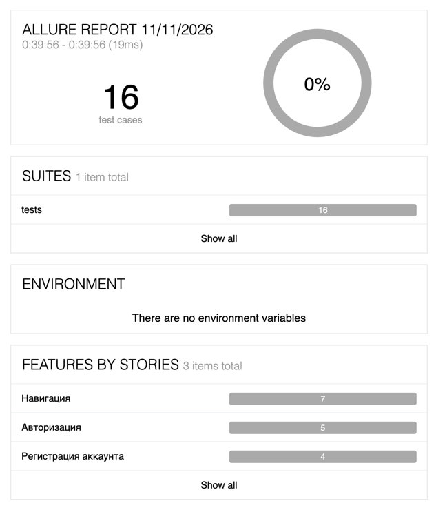

# UI-тесты Stellar Burgers

Автотесты интерфейса [Stellar Burgers](https://stellarburgers.education-services.ru) на Python, pytest и Selenium (Page Object).

## Структура

```text
config/           # URL и пользователи окружений (dev / stage)
pages/            # Page Object: главная, логин, регистрация, восстановление пароля
tests/            # Сценарии: логин, регистрация, навигация
conftest.py       # Фикстуры драйвера и страниц, CLI-флаги
pytest.ini        # Значения по умолчанию и маркеры
Dockerfile        # Образ для изолированного прогона
docker-compose.yaml
```

## Подготовка (локально)

1. Python 3.11+
2. Google Chrome (для `--browser=chrome`) или Firefox
3. Виртуальное окружение и зависимости:

```bash
python3 -m venv .venv
source .venv/bin/activate   # Windows: .venv\Scripts\activate
pip install -r requirements.txt
```

## Запуск тестов

Окружение задаётся флагом `--env`: `dev` или `stage` (см. `config/environments.py`).

```bash
pytest                 # по умолчанию: chrome, headed, env=dev
pytest --env=dev
pytest --env=stage
pytest --headless      # без GUI
```

Если URL stage отличается от dev, задайте его в `config/environments.py`.

### Полезные флаги (`conftest.py`)

| Флаг | Значения | По умолчанию |
|------|----------|--------------|
| `--env` | `dev`, `stage` | `dev` (`pytest.ini`) |
| `--browser` | `chrome`, `firefox` | `chrome` или `BROWSER` |
| `--headless` | флаг `store_true` | выкл. локально; в Docker — `HEADLESS=true` |
| `--device` | `mobile`, `tablet`, `laptop`, `desktop` | `desktop` (1280×800) |
| `--user-type` | ключ из `common_users` | пользователь окружения |

Примеры:

```bash
pytest --browser=firefox
pytest --headless
pytest --device=mobile
pytest -m smoke
pytest -m regression
```

`--headless` и `--browser` не кладём в `addopts`: иначе нельзя опереться на `HEADLESS` / `BROWSER` из окружения (и `--headless` как `store_true` нельзя выключить из CLI).

### Параллельный прогон (`pytest-xdist`)

```bash
pytest -n auto
pytest --env=stage -n auto
```

## Allure

Сырые результаты пишутся в `allure-results` (`--alluredir` в `pytest.ini`).

1. Установите [Allure Commandline](https://github.com/allure-framework/allure2/releases); нужна Java, команда `allure` должна быть в `PATH`.
2. Откройте отчёт:

```bash
allure serve allure-results
```

Или статическая сборка:

```bash
allure generate allure-results -o allure-report --clean
allure open allure-report
```

## Docker

Контейнер нужен, чтобы прогонять тесты без локального Chrome и Python-окружения. Внутри — Python 3.11, зависимости проекта и **Chromium + chromedriver** (headless).

Переменные образа / compose, которые читает `conftest.py`:

- `CHROME_BIN=/usr/bin/chromium`
- `CHROMEDRIVER_PATH=/usr/bin/chromedriver`
- `BROWSER=chrome` — в образе только Chromium
- `HEADLESS=true` — headless без флага в `pytest.ini`

Том `./allure-results:/app/allure-results` в `docker-compose.yaml` сохраняет отчёт на хосте.

Нужны Docker Desktop / Docker Engine и Compose.

Сборка образа и прогон всех тестов:

```bash
docker compose up --build
```

После завершения контейнер останавливается, результаты лежат в `./allure-results`. Отчёт на хосте:

```bash
allure serve allure-results
```

Другое окружение или набор тестов — через `run` (подменяется `CMD` из Dockerfile):

```bash
docker compose run --rm stellar-burgers-tests pytest --env=stage
docker compose run --rm stellar-burgers-tests pytest -m smoke
```

CI/CD (GitHub Actions)
Пайплайн описан в .github/workflows/tests.yml.

Когда запускается: на каждый push.

Что делает:

Собирает и запускает тесты (Клонирует репозиторий, устанавливает зависимости и гоняет тесты).
Генерирует Allure-отчёт из allure-results.
Сохраняет отчёт как artifact allure-report (хранение 14 дней).
Как посмотреть отчёт из CI:

Откройте вкладку Actions у репозитория.
Выберите успешный (или завершённый) workflow run.
Внизу страницы artifact с ссылкой на отчет

### Пример Allure-отчёта

Ниже представлен пример дашборда отчёта.

